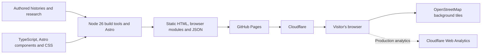
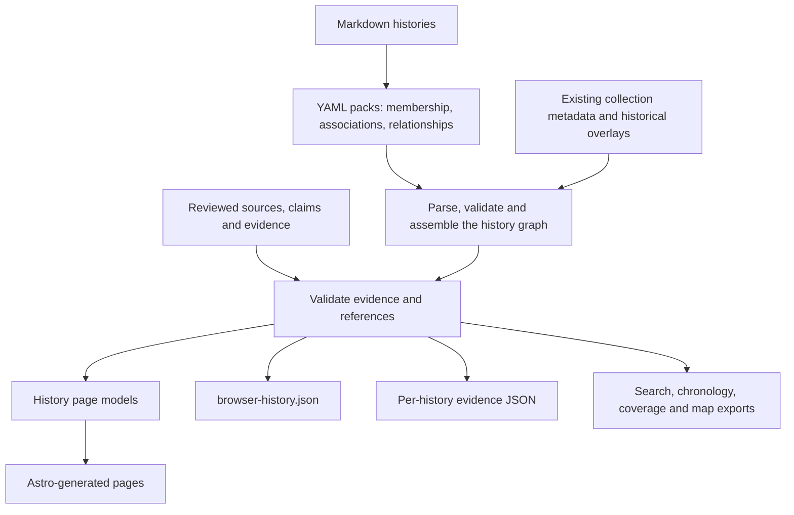
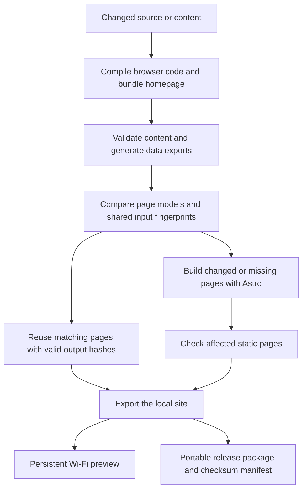
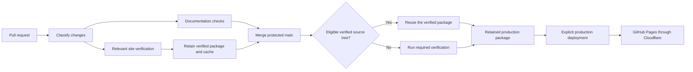

# Historica architecture

Historica is a static website with browser-side exploration. Astro builds the pages, TypeScript supplies the interactions, and GitHub Pages serves the resulting files through Cloudflare. There is no application server or database running in production.

This document describes the current implementation. For setup, see [README](README.md); for contributions, [CONTRIBUTION](CONTRIBUTION.md); for publishing and recovery, [RELEASE](RELEASE.md).

## The main parts

The browser downloads the assembled history graph so it can compare dates, places and people without making a server request for each interaction. Evidence is loaded separately by history when needed. Authored content is split across files even though some browser exports combine it into larger JSON documents.

| Location | Responsibility |
| --- | --- |
| `content/histories/` | One Markdown record per person, place, period or event |
| `content/packs/` | YAML pack membership, relationships and dated place associations |
| `research/` | Sources, claims, evidence reviews and coverage records |
| `src/pages/`, `src/layouts/`, `src/components/` | Astro routes and generated HTML |
| `src/domain/` | History types and calculations: dates, comparisons, geography and search |
| `src/state/` | Focus changes, history-page bookmarks and navigation snapshots |
| `src/presentation/` | Page models, rendered sections and map presentation |
| `src/controllers/` | History-page controls and event handling |
| `src/browser/`, `src/entrypoints/` | Browser startup, orchestration, theme and analytics |
| `src/explorer/` | The homepage map, Browse view, result grouping and mobile sheet |
| `src/content/` | Parsers, validation and browser data/evidence loading |
| `scripts/` | Source loading, builds, verification, packaging and local preview |
| `web/` | Shared styles and assets, compatibility files and generated local site |
| `tests/` | Domain, interaction, build and generated-page checks |

## Historical data and evidence

A `HistoryEntity` has a stable ID, one of six types (`person`, `area`, `state`, `city`, `period`, `event`), a date interval and descriptive content. It can also have an approximate reference point, uncertainty and source or claim references.

A `PlaceAssociation` connects a subject to a place during a dated interval. A `HistoryRelationship` connects two entities and can carry dates, directional labels and sources. These distinctions matter: a person's reference point isn't a claim that they lived there throughout their life, and a connection doesn't imply that two people met.

Dates use negative integers for BCE and positive integers for CE, with no year zero. Shared timeline utilities convert to a continuous ordinal scale for arithmetic. Geography uses longitude/latitude pairs. Validation checks these conventions and references; it doesn't establish historical accuracy.

`scripts/lib/history-content.ts` reads the authored records and packs. `scripts/build-evidence.ts` validates and produces browser exports. `scripts/static/history-page.ts` assembles the inputs used to create each static history page through the presentation layer.

Some established inputs still use names such as `prototype`: the pack in `content/packs/`, compatibility metadata and `web/data/collection.json` remain part of the data pipeline. They are distinct from the retired standalone design prototype. Don't delete them on the strength of their names.

Use [Adding facts](project/adding-facts.md) for the authoring workflow and [the evidence format](research/evidence/FORMAT.md) for source records. Generated JSON is an output, not the place to edit a fact.

## Two ways into the collection

### Map and Browse homepage

`src/pages/index.astro` uses `ExplorerLayout.astro`. It generates Browse links in HTML so entries remain reachable before JavaScript runs. `src/explorer/app.ts` then adds the Map/Browse interaction and loads the browser history graph and modern country geometry.

The homepage uses Leaflet for map movement and zooming. `model.ts` groups histories at shared or nearby locations, `state.ts` validates periods and chooses a country's main geographic component, and `sheet.ts` handles the draggable phone panel. Results update after map movement settles. Resizing the sheet preserves the current results.

Country search loads a small generated index of names and mainland bounds; the results still describe the visible map area. It isn't an exact country-membership query. Dated associations are used where available, without substituting a timeless reference location when those dates don't match.

The basemap provider is configured in `web/data/map-service.json`. Background tiles load in Map mode; Browse doesn't need them. Leaflet itself is bundled with the site rather than downloaded from a script CDN.

### History pages

`src/pages/[type]/[id].astro` generates routes such as `/person/alexander/` and `/area/egypt/`. Each page contains its initial introduction, comparisons, timeline, map and evidence. `src/entrypoints/focus-app.ts` starts `src/browser/explorer.ts`, which connects the domain queries, state, controllers and rendering modules.

The history-page map is the SVG-based related-places view. A content-hashed SVG holds the shared modern borders, referenced by each page with `<use>`. Historical overlays and focus highlights remain in the page. `scripts/build-map-regions.ts` generates the shared SVG, regional geometry and country-search index from Natural Earth data. It doesn't use the homepage's Leaflet map. The two views share historical data and date conventions but have separate interaction code.

There is one focus at a time. Selecting a person or event normally uses that record's interval; moving to an area, state or city retains the current period. The shared navigation code applies these rules rather than leaving individual controls to invent them.

### URLs and local state

History pages use a path for the focus and query parameters for the chosen period and other view settings. Their navigation code manages browser history and snapshots. Some older fragment routes remain supported by isolated compatibility code.

The homepage query string records the camera, dates, selected places and Browse filters. Map movement replaces the current URL, so browser Back doesn't walk through every pan. A tab-specific session-storage entry lets a history page return to the originating Map or Browse view. Return URLs are constrained to the site's explorer path.

Appearance and the dismissed introductory hint are stored locally. There are no visitor accounts or server-side saved views. The [privacy page source](src/pages/privacy.astro) describes local preferences, map requests and production analytics.

## Building and checking

Node.js 26 is pinned in `.node-version`. TypeScript compilation emits browser modules into `web/generated/`; esbuild also bundles the homepage and Leaflet into a content-hashed module. Build scripts use the compiled domain and presentation code so static output and browser interactions share calculations.

`npm run build:web` prepares content, builds and verifies the required static pages, then exports them into the local `web/` tree. `npm run preview:sync` runs that build and copies the result to the persistent Wi-Fi preview. It doesn't publish anything.

The incremental cache is under `release/static-incremental/`. A page fingerprint includes its model and shared inputs. Output hashes guard against stale or modified files. Shared code, styles or build changes can invalidate all pages. A separate record tracks which fingerprints passed static tests: generating a page doesn't itself mark it verified.

This is incremental page generation and static-page verification, not a claim that every build step or unit test runs incrementally. Content assembly still runs, and shared application changes need broader checks.

`web/generated/`, generated routes/data, `.astro/` and `release/` are ignored outputs. `web/` also contains authored assets, so it must not be treated as wholly disposable. Release and cutover recovery files need separate retention decisions.

## CI, deployment and hosting

Main is protected and changes arrive through PRs. CI classifies changes before choosing the verification path:

- Recognised internal documentation changes skip site generation and deployment.
- Eligible sharing-image changes use focused checks against an existing verified release.
- Site changes take the normal verification path, with page-cache reuse where valid. Unknown changes conservatively take this path too.

The package path after merge applies to site releases. Documentation-only merges stop without producing or deploying a site package. Matching a successful PR's source tree allows main to reuse its package without another build or test run. Missing or ineligible artifacts fall back to verification.

Deployment is a separate workflow. It accepts a successful main verification run, checks the intended production domain and file hashes, and publishes the retained package. Merging a PR doesn't automatically publish the site. An earlier retained production package can be deployed through the same workflow for recovery.

Cloudflare proxies the public domain and provides visitor-facing HTTPS. Ian has chosen to keep this arrangement and leave GitHub's custom-domain certificate setting alone. The Historica-only fallback and previous hosting recovery material are described in [the hosting record](project/github-pages-cutover.md). No other Cloudflare projects are part of Historica's architecture.

## Where to make changes

For a fact or connection, edit the authored record, pack and supporting evidence. For a homepage interaction, start in `src/explorer/`; for a history-page interaction, start with its controller and shared state or domain function. Astro components own static markup, while shared CSS remains in `web/`.

Keep domain calculations independent of browser event handling, and reuse them when static and interactive output need the same result. Don't introduce another data store or rendering path simply to add a new view. The current limits, release status and outstanding operational follow-ups are recorded in [release status](project/release-readiness.md).
